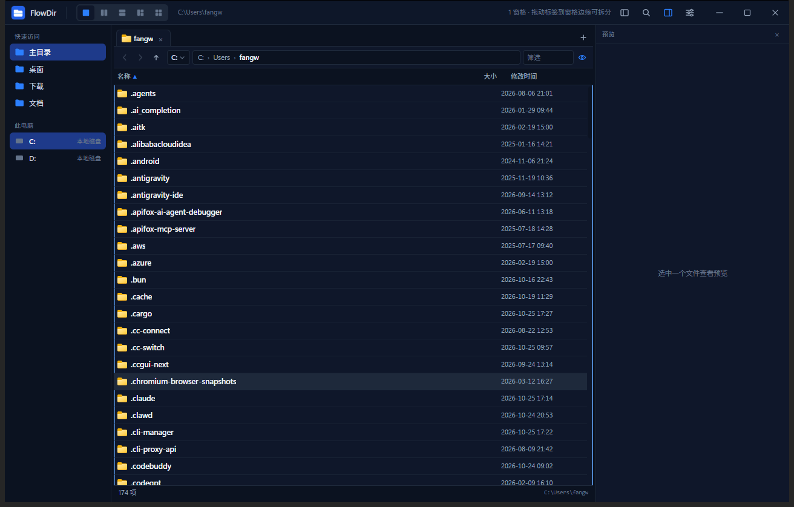
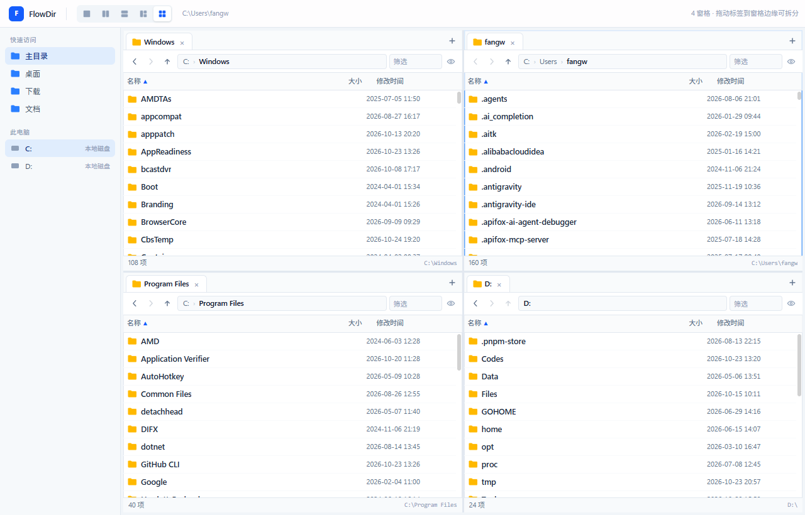
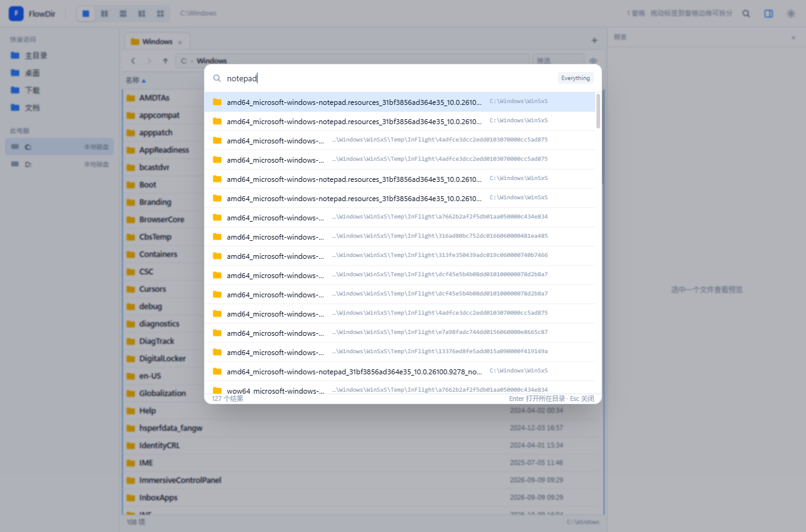
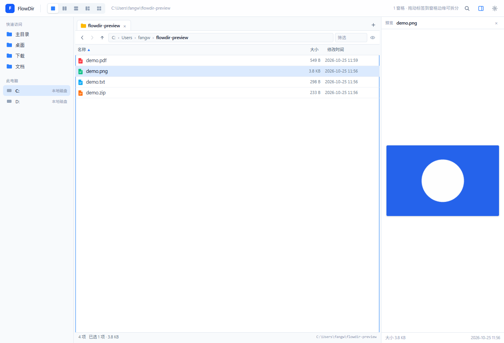
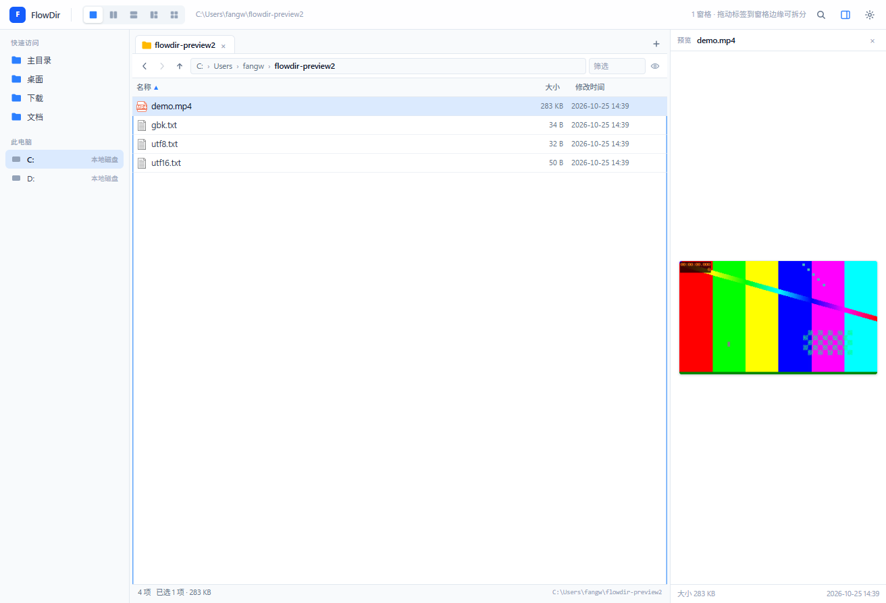
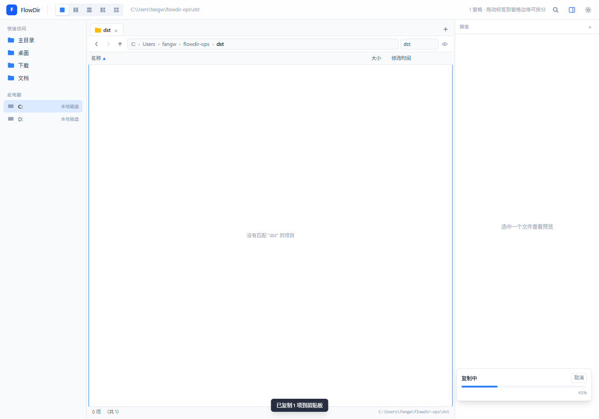
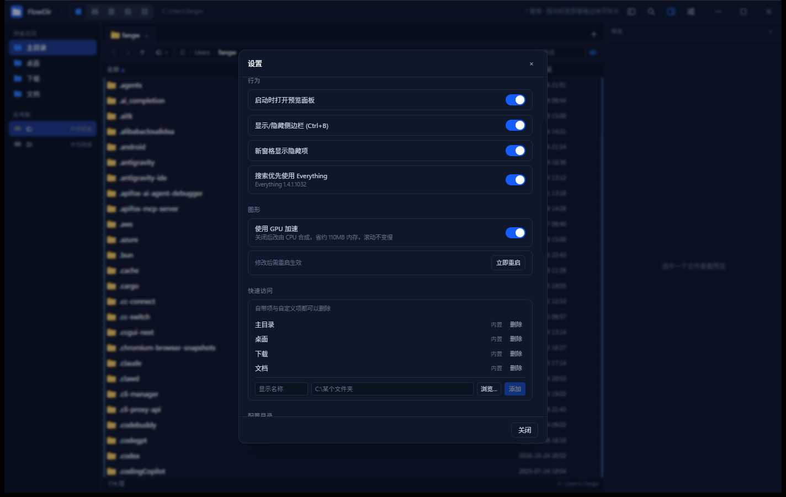
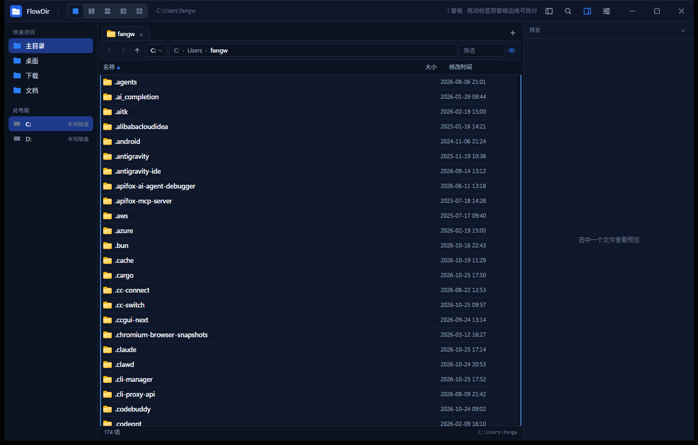

# FlowDir

Windows 文件管理器：多窗格 + 标签、原生 Shell 集成、低内存占用。
Tauri 2 + Rust 后端，React 19 前端。

[](https://github.com/fangweilong/flow-dir/actions/workflows/release.yml)

<p align="center">
  
</p>

**快速导航**：[特性](#特性) · [界面](#界面) · [安装](#安装) · [更新](#更新) · [开发](#开发) · [配置与数据](#配置与数据) · [性能](#性能) · [发布](#发布) · [已知限制](#已知限制)

## 特性

### 窗格与目录树

- 布局：单窗格、左右/上下双窗格、三窗格、四窗格。
- 每个窗格标签数不限；标签可跨窗格拖动，拖到窗格边缘即拆分。
- 新建标签打开「此电脑」盘符总览，双击盘符进入目录。
- 侧栏宽度可拖动，拖到最窄自动收起；中间窗格始终不少于一半宽度。
- 目录树随当前标签自动展开并高亮所在目录：展开先渲染缓存、再后台刷新，只拉取展开节点的子目录。

### 浏览

- 批量枚举 + 虚拟列表，只渲染可视行。
- 四种视图：详细信息、列表、图标、缩略图（状态栏右侧切换，按窗格保存）。
- 支持系统命名空间位置：回收站、控制面板（侧栏快速访问），右键走系统菜单（回收站可还原/删除）。
- 隐藏/系统项与符号链接/快捷方式有不同的颜色和角标；可配置通配符颜色规则（前景/背景）。
- 空处右键可一次性递归统计当前目录大小，结果显示在状态栏，可随时取消。
- 键入即定位，兼容输入法。
- 面包屑导航，前进/后退支持 `Alt+←/→` 与鼠标侧键。
- `Ctrl+L` 地址栏、磁盘下拉切换、文件名筛选、隐藏/系统项开关。
- 盘符总览显示卷标、文件系统、已用/容量与剩余空间：
  - 「容量/剩余」列可拖动宽度，双击恢复默认；
  - 盘符右键可看属性、弹出可移动设备；
  - 同时列出 `%APPDATA%\Microsoft\Windows\Network Shortcuts` 中的「网络位置」（UNC 站内浏览，WebDAV 等 URL 目标交给系统打开）。
- 大目录边扫描边显示进度，达到上限时明确提示截断。

### 搜索

- 优先使用 Everything（本机运行时）；不可用时自动降级为内置 `jwalk` 扫描。两者都返回文件与文件夹。
- `Ctrl+F` 呼出，`Enter` 打开命中项，`Alt+Enter` 打开所在目录。
- 内置扫描跟随隐藏项设置。
- 搜索范围：当前目录、当前磁盘、各个打开的标签、所有打开的标签（跨窗格联动）。
- 排序维度：名称、大小、修改时间、所在目录、文件类型。

### 预览

| 类型 | 实现 |
| --- | --- |
| 图片 | WIC 缩放解码 |
| PDF | 首页 |
| 视频 | 首帧 |
| 文本 | BOM / UTF-8 / GBK 回退；未知扩展名按内容嗅探 |
| 压缩包 | ZIP 目录 |
| 可执行文件 | EXE/DLL 版本信息 |

- 超过 64 MB 不生成预览。
- Word/Excel 等内置不支持的类型，可在设置里按扩展名绑定外部预览程序；选中文件按 `F3`（可改）直接调用。

### 文件操作

- 复制、移动、回收站删除、重命名、新建文件夹，全部走 `IFileOperation`。
- 删除前二次确认（回收站与永久删除分别提示）；同名冲突的替换/覆盖由系统自身询问，不会静默覆盖。
- 带进度、取消与逐项失败列表，部分失败不会误报成功。
- `Ctrl+Z` 按栈撤销最近 10 次；回收站删除走 Shell 还原，永久删除明确提示不可撤销。
- 任务栏显示聚合进度；窗口在后台完成时发系统通知并闪烁任务栏。
- 右键为系统原生菜单（含第三方扩展），目录空白处额外追加隐藏项开关；盘符总览保留轻量自绘菜单。

### 拖放

- 文件可在窗格、目录树、快速访问之间拖动。
- 默认同卷移动、跨卷复制；`Ctrl` 复制、`Shift` 移动、`Esc` 取消。
- 支持从资源管理器拖入；拖出到资源管理器/桌面走 OLE `CF_HDROP`。

### Git 状态

| 标记 | 含义 |
| --- | --- |
| `M` | 已修改 |
| `A` | 已新增 |
| `D` | 已删除 |
| `R` | 已重命名 |
| `U` | 未跟踪 |
| `!` | 冲突 |

- 未跟踪目录内的文件同样逐个显示 `U`；含改动的目录显示圆点。
- 包含 `.git` 的文件夹在图标右下角显示状态角标：绿勾=干净、铅笔=未提交、↑/↓=未推送/落后、红色 `!`=冲突。
- 底部状态栏常驻当前分支、未提交标记与 ↑/↓ 上游差距（未设置上游时标注「无上游」）。
- 进入目录时后台取一次 `git status`；`F5`、文件操作、目录变动与 `git add`/`commit` 会重新取；非仓库或未安装 git 时静默不显示。

### 外观与快捷键

| 项目 | 选项 |
| --- | --- |
| 主题 | 深色、浅色、跟随系统 |
| 语言 | 中文、英文 |
| 文件图标 | 系统原生、内置扁平、Material、Catppuccin（随深浅色切换 Mocha/Latte） |
| 界面字体 | 常见系统字体或自定义已安装字体 |
| 字号 | 12–20 px 实时生效；行高、列宽、图标与设置页整体按字号缩放 |
| 快捷键 | 设置内置总表，可逐项重新绑定（含新建/关闭标签），冲突即时提示 |

### 系统集成与诊断

- 单实例、托盘、原生窗口阴影与深色菜单、`Alt+Enter` 属性页。
- WebView2 GPU 加速可在设置中关闭以省内存；最小化时自动挂起渲染进程。
- 自动更新：按可配置间隔检查 GitHub Release；单文件版原地替换，安装版静默升级。
- 后端关键路径（枚举、搜索、git、文件操作、更新）与前端异常写入滚动日志：单文件 2 MB、保留 5 份，panic 带位置与 backtrace。
- 渲染异常由 ErrorBoundary 接管并可重载；设置页可切换日志级别、打开日志目录、导出诊断包（日志 + 版本信息 + 脱敏设置，不含自定义路径与布局）。

## 界面

<table>
  <tr>
    <td width="50%"><br><sub>四窗格布局，标签可跨窗格拖动拆分</sub></td>
    <td width="50%"><br><sub>Ctrl+F 搜索，优先走 Everything</sub></td>
  </tr>
  <tr>
    <td><br><sub>右侧预览：图片缩放解码</sub></td>
    <td><br><sub>视频首帧预览</sub></td>
  </tr>
  <tr>
    <td><br><sub>复制/移动进度卡片，可随时取消</sub></td>
    <td><br><sub>设置：行为、GPU 加速、快速访问</sub></td>
  </tr>
</table>

<p align="center">
  <br>
  <sub>深色主题与隐藏项显示</sub>
</p>

## 安装

从 [Releases](https://github.com/fangweilong/flow-dir/releases) 下载，二选一：

| 文件 | 说明 |
| --- | --- |
| `FlowDir_<version>_x64_portable.exe` | 单文件版，免安装，更新时原地替换自身 |
| `FlowDir_<version>_x64-setup.exe` | NSIS 安装版，安装到当前用户目录，写入卸载项，更新时静默升级 |

要求 Windows 10/11 x64，并具备 WebView2 运行时（Windows 11 及较新的 Windows 10 已内置）。两种形态共用同一份配置目录。

## 更新

设置 → 关于与更新：显示当前版本与构建形态，可手动检查、一键下载安装，并展开查看每个版本的发布记录（来自 GitHub Releases，缓存 6 小时）。同一页还提供项目地址、作者主页与依赖仓库/许可链接。

| 项 | 说明 |
| --- | --- |
| 自动检查间隔 | 6 / 12 / 24 / 72 小时或关闭；默认 24 小时，`0` = 仅手动 |
| 版本来源 | Release 资产 `latest.json`（版本号 + 两个安装包的文件名、大小、SHA-256）；版本记录经 GitHub Releases API 读取并缓存 |
| 下载校验 | 大小、PE 头、SHA-256 摘要全部通过后才执行替换/安装 |
| 仓库要求 | 必须保持 **public**，否则匿名拉取 `latest.json` 会失败 |

## 开发

依赖：Node.js 22+、Rust stable（MSVC，见 `src-tauri/rust-toolchain.toml`）、Visual Studio Build Tools 与 Windows SDK。

| 命令 | 用途 |
| --- | --- |
| `npm ci` | 安装依赖 |
| `npm run dev:app` | 开发版（Vite + Tauri），独立 identifier 与数据目录，可与正式版同时运行 |
| `npm run tauri dev` | 老旧方式：沿用正式版 identifier，会与正式版抢占单实例锁 |
| `npm run tauri build` | 产物：`src-tauri/target/release/flowdir.exe` + NSIS 安装包 |
| `cd src-tauri && cargo test` | Rust 单测 |

开发版由 `src-tauri/tauri.dev.conf.json` 覆盖 identifier 为 `dev.flowdir.app.dev`。单实例锁、数据目录、窗口标题/托盘提示全部由该值派生：

| | 开发版 | 正式版 |
| --- | --- | --- |
| identifier | `dev.flowdir.app.dev` | `dev.flowdir.app` |
| `%APPDATA%` | `FlowDir-dev` | `FlowDir` |
| `%LOCALAPPDATA%` | `FlowDir-dev` | `FlowDir` |
| 标题/托盘 | `FlowDir Dev` | `FlowDir` |
| 自更新 | 禁止替换 `target/` 下的二进制 | 正常替换 |

## 配置与数据

| 路径 | 内容 |
| --- | --- |
| `%APPDATA%\FlowDir\settings.toml` | 语言、主题、界面字体与字号（`font_family` / `font_size`）、GPU、快速访问、更新间隔等；带注释，手工改也安全，非法字号回退 13 |
| `%APPDATA%\FlowDir\layout.json` | 窗格/标签/窗口几何，启动恢复；损坏时降级并保留 `.rejected.json` |
| `%APPDATA%\FlowDir\update.json` | 上次更新检查时间、最近一次发现的版本与发布记录缓存 |
| `%LOCALAPPDATA%\FlowDir\EBWebView` | WebView2 浏览器配置 |

## 性能

Rust 侧分批枚举 + 前端虚拟列表，只渲染可视行。本机实测：

| 目录 | 项目数 | 全部到齐 |
| --- | --- | --- |
| `C:\Windows\System32` | 4,931 | 约 0.44 s（首行 30 ms） |
| `WinSxS` | 25,773 | 约 0.53 s（DOM 仅 51 个行节点） |

## 发布

版本号在 `package.json`、`src-tauri/Cargo.toml`、`src-tauri/tauri.conf.json` 三处必须一致。发版只需同时递增三处并 push `main`：`release.yml` 检测到 `v<version>` 尚未发布后自动编译、打包并创建 Release（单文件版、NSIS 安装包、`latest.json`）。版本未变则整条流水线跳过；需要重建已发布版本时手动触发 workflow 并勾选 `force`。

细节与约束见 [AGENTS.md](AGENTS.md)。

## 目录结构

```
src/              React 前端（文件列表、预览、搜索、设置）
src-tauri/src/    Rust 后端（枚举/扫描、文件操作、预览、Shell 菜单、更新）
src-tauri/icons/  应用图标
screenshots/      README 与文档截图
.github/          Release 流水线
```

## 已知限制

- 仅支持 Windows。
- 拖出到资源管理器依赖目标应用的 `CF_HDROP` 拖放支持；个别第三方拖放目标可能拒绝文件列表。
- 以管理员身份运行时，Windows 的 UIPI 会拦截向普通权限程序（资源管理器、VS Code 等）的拖放；需要拖出时请以普通权限启动 FlowDir。系统关闭 UAC 时所有程序都会以管理员权限启动，标题栏权限按钮会说明此时无法切换；需要普通权限请开启 UAC 并重新登录。
- 系统通知在单文件免安装形态下可能被 Windows 的 AUMID 规则拦下，此时仍会闪烁任务栏并在界面内提示。
- Everything 为可选依赖，未安装或未运行时使用内置扫描。

## 第三方图标资源

`src/assets/icon-themes/` 下的图标改自以下 MIT 项目，许可证原文随目录保存：

| 主题 | 来源 | 许可证 |
| --- | --- | --- |
| `material` | [Material Icon Theme](https://github.com/material-extensions/vscode-material-icon-theme) — © 2025 Material Extensions | [MIT](https://github.com/material-extensions/vscode-material-icon-theme/blob/main/LICENSE) |
| `catppuccin-mocha`、`catppuccin-latte` | [Catppuccin Icons for VSCode](https://github.com/catppuccin/vscode-icons) — © 2023 Catppuccin / thang-nm | [MIT](https://github.com/catppuccin/vscode-icons/blob/main/LICENSE) |
