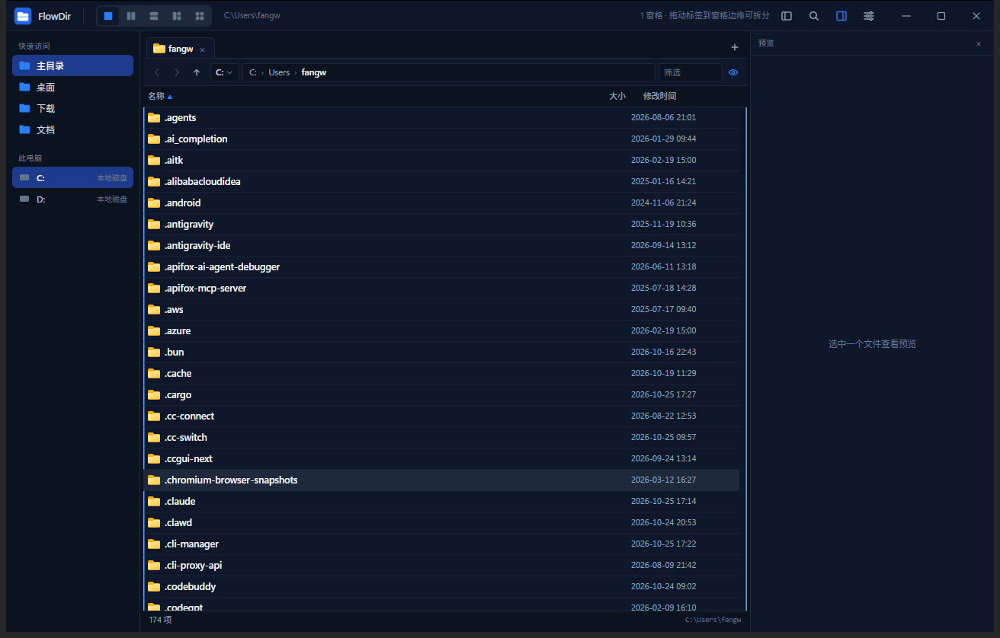
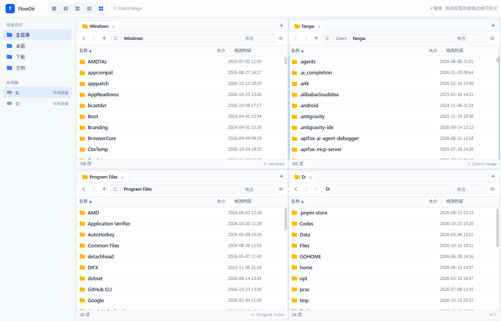
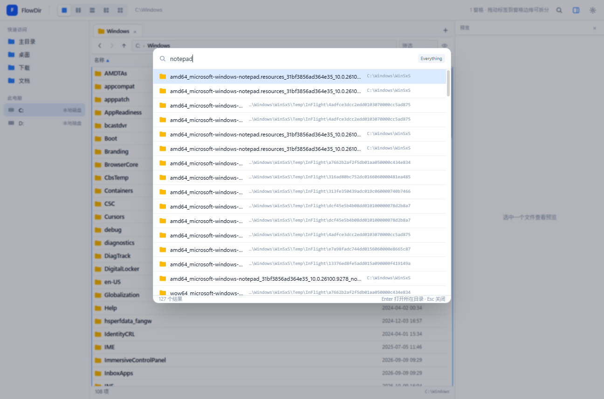
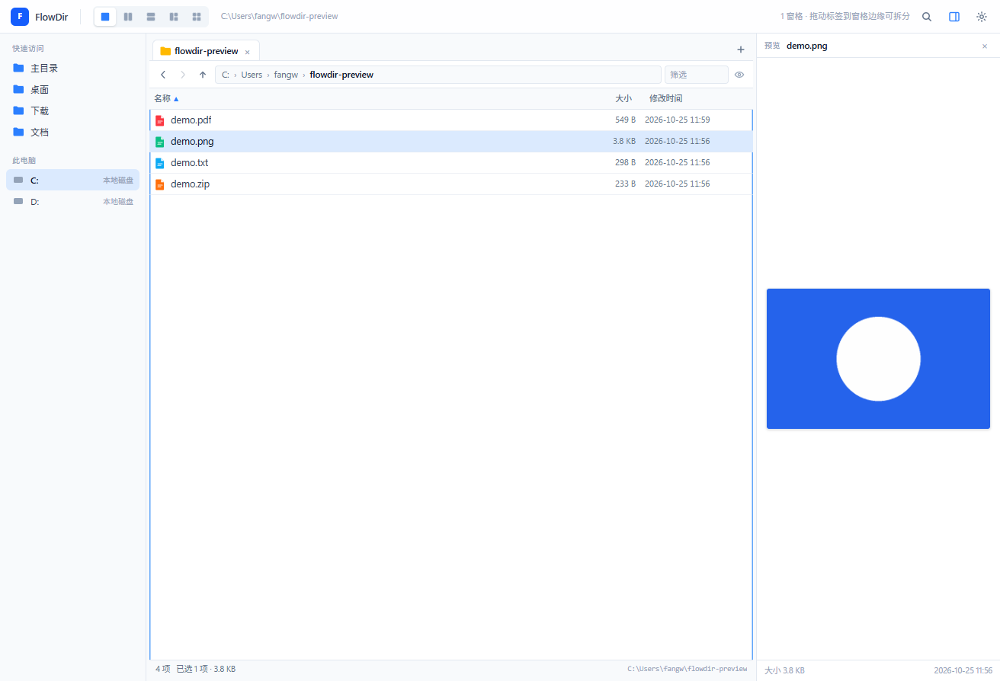
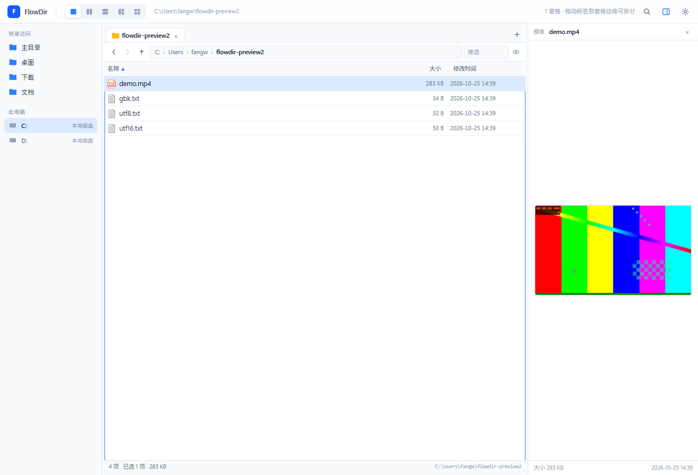
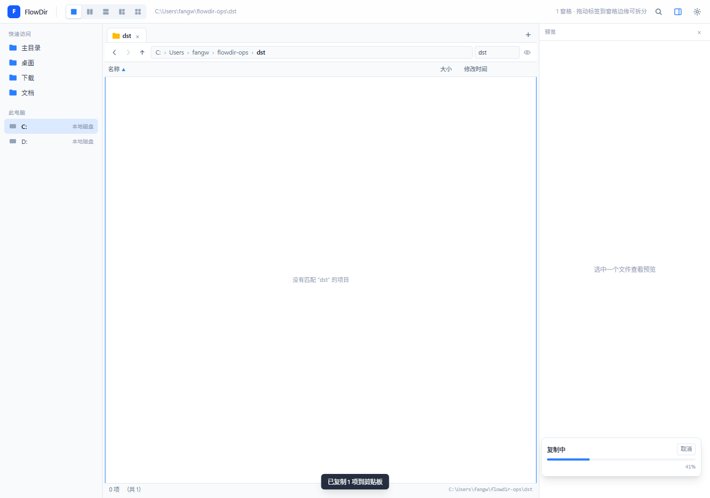
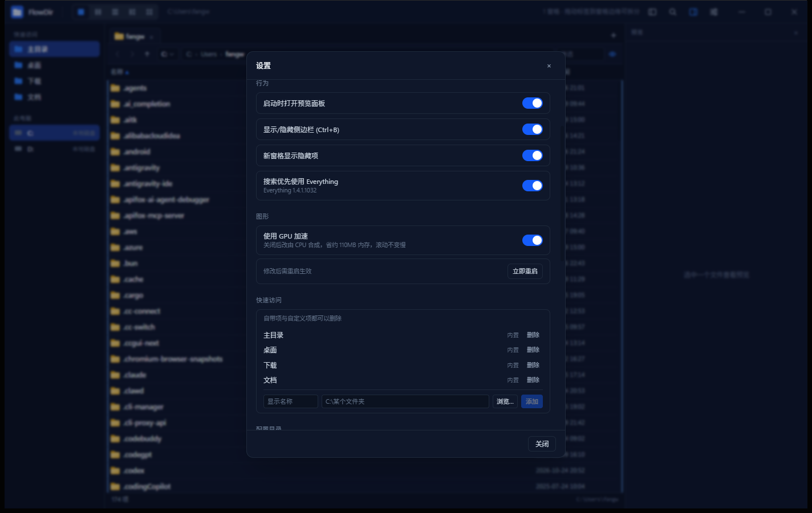
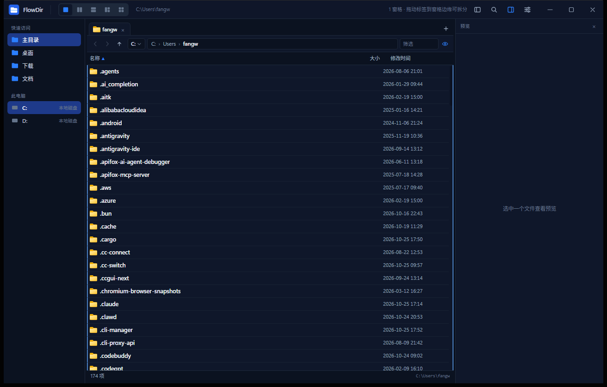

# FlowDir

Windows 文件管理器：多窗格 + 标签、原生 Shell 集成、低内存占用。Tauri 2 + Rust 后端，React 19 前端。

[](https://github.com/fangweilong/flow-dir/actions/workflows/release.yml)

<p align="center">
  
</p>

## 特性

- **目录树**：左侧树随当前标签自动展开并高亮所在目录；展开先渲染缓存、再后台刷新，只拉取展开节点的子目录。
- **布局**：单窗格、左右/上下双窗格、三窗格、四窗格；每窗格无限标签，标签可跨窗格拖动，拖到窗格边缘即拆分。新建标签打开「此电脑」盘符总览，从盘符双击进入目录。左右两侧栏可拖动改宽，拖到最窄自动收起，中间窗格始终不少于一半宽度。
- **浏览**：批量枚举 + 虚拟列表、键入即定位（兼容输入法）、面包屑与前进/后退、`Ctrl+L` 地址栏、磁盘下拉切换、文件名筛选、隐藏/系统项开关；盘符总览显示卷标、文件系统、已用/容量与剩余空间，「容量/剩余」列可拖拽宽度、双击恢复默认，盘符右键可看属性、弹出可移动设备；大目录边扫描边显示进度，达到上限时明确提示截断；盘符总览同时列出 `%APPDATA%\Microsoft\Windows\Network Shortcuts` 里的「网络位置」（UNC 站内浏览，WebDAV 等 URL 目标交给系统打开）。
- **拖放**：文件可在窗格、目录树、快速访问之间拖动（默认同卷移动、跨卷复制，`Ctrl` 复制、`Shift` 移动、`Esc` 取消），支持从资源管理器拖入；拖出到资源管理器/桌面走 OLE `CF_HDROP`。
- **Git 状态**：文件列表按仓库显示 `M/A/D/R/U/!` 变更字母，未跟踪目录内的文件同样逐个显示 `U`，含改动的目录显示圆点；包含 `.git` 的文件夹在图标右下角显示状态角标（绿勾=干净、铅笔=未提交、↑/↓=未推送/落后、红色 `!`=冲突）；底部状态栏常驻当前分支、未提交标记与 ↑/↓ 上游差距（未设置上游时标注「无上游」）；进入目录时后台取一次 `git status`，`F5`、文件操作、目录变动与 `git add`/`commit` 会重新取，非仓库或未安装 git 时静默不显示。
- **搜索**：优先使用 Everything（本机运行时），不可用时自动降级为内置 `jwalk` 扫描，两者都返回文件与文件夹；`Ctrl+F` 呼出，`Enter` 打开命中项，`Alt+Enter` 打开所在目录，内置扫描跟随隐藏项设置。
- **预览**：WIC 缩放解码图片、PDF 首页、视频首帧、文本（BOM / UTF-8 / GBK 回退，未知扩展名按内容嗅探）、ZIP 目录、EXE/DLL 版本信息；超过 64 MB 不生成预览；Word/Excel 等内置不支持的类型可在设置里按扩展名绑定外部预览程序，选中文件按 `F3`（可改）直接调用。
- **文件操作**：复制、移动、回收站删除、重命名、新建文件夹，全部走 `IFileOperation`；删除前二次确认（回收站与永久删除分别提示），同名冲突的替换/覆盖由系统自身询问（未静默）；带进度、取消与逐项失败列表（部分失败不再误报成功）；`Ctrl+Z` 按栈撤销最近 10 次（回收站删除走 Shell 还原，永久删除明确提示不可撤销）；任务栏显示聚合进度，窗口在后台完成时发系统通知并闪烁任务栏；文件/文件夹右键与目录空白处右键均为系统原生菜单（含第三方扩展，空白处额外追加隐藏项开关），盘符总览保留轻量自绘菜单。
- **系统集成**：单实例、托盘、原生窗口阴影与深色菜单、`Alt+Enter` 属性页。
- **外观与语言**：深浅色/跟随系统、中英双语；界面字体可选常见系统字体或自定义已安装字体，字号 12–20 px 实时生效，行高、列宽、图标与设置页整体按字号缩放。
- **快捷键**：设置内置快捷键总表，可逐项重新绑定（含新建/关闭标签），冲突即时提示。
- **资源占用**：WebView2 GPU 加速可在设置中关闭以省内存，最小化自动挂起渲染进程。
- **自动更新**：按可配置间隔检查 GitHub Release，单文件版原地替换，安装版静默升级。
- **诊断**：后端关键路径（枚举、搜索、git、文件操作、更新）与前端异常写入滚动日志（单文件 2 MB、保留 5 份，panic 带位置与 backtrace）；渲染异常由 ErrorBoundary 接管并可重载；设置页可切换日志级别、打开日志目录、导出诊断包（日志 + 版本信息 + 脱敏设置，不含自定义路径与布局），并可开关覆盖全窗口的隐形水印（版本、系统版本、当前时间，默认开启）。

## 界面

<table>
  <tr>
    <td width="50%"><br><sub>四窗格布局，标签可跨窗格拖动拆分</sub></td>
    <td width="50%"><br><sub>Ctrl+F 搜索，优先走 Everything</sub></td>
  </tr>
  <tr>
    <td><br><sub>右侧预览：图片缩放解码</sub></td>
    <td><br><sub>视频首帧预览</sub></td>
  </tr>
  <tr>
    <td><br><sub>复制/移动进度卡片，可随时取消</sub></td>
    <td><br><sub>设置：行为、GPU 加速、快速访问</sub></td>
  </tr>
</table>

<p align="center">
  <br>
  <sub>深色主题与隐藏项显示</sub>
</p>

## 安装

从 [Releases](https://github.com/fangweilong/flow-dir/releases) 下载，二选一：

| 文件 | 说明 |
| --- | --- |
| `FlowDir_<version>_x64_portable.exe` | 单文件版，免安装，更新时原地替换自身 |
| `FlowDir_<version>_x64-setup.exe` | NSIS 安装版，安装到当前用户目录，写入卸载项，更新时静默升级 |

要求 Windows 10/11 x64，并具备 WebView2 运行时（Windows 11 及较新的 Windows 10 已内置）。两种形态共用同一份配置目录。

## 更新

设置 → 更新：显示当前版本与构建形态，可手动检查、一键下载安装；自动检查间隔可选 6/12/24/72 小时或关闭（默认 24 小时，`0` = 仅手动）。

版本信息来自 Release 资产 `latest.json`（版本号 + 两个安装包的文件名、大小、SHA-256）。应用下载后校验大小、PE 头与 SHA-256 摘要，通过后才执行替换/安装。仓库需保持 **public**，否则匿名拉取 `latest.json` 会失败。

## 开发

依赖：Node.js 22+、Rust stable（MSVC，见 `src-tauri/rust-toolchain.toml`）、Visual Studio Build Tools 与 Windows SDK。

```bash
npm ci
npm run dev:app           # 开发版（Vite + Tauri，独立 identifier 与数据目录，可与正式版同时运行）
npm run tauri dev         # 老旧方式：沿用正式版 identifier，会与正式版抢占单实例锁
npm run tauri build       # 产物：src-tauri/target/release/flowdir.exe + NSIS 安装包
```

开发版由 `src-tauri/tauri.dev.conf.json` 覆盖 identifier 为 `dev.flowdir.app.dev`。单实例锁、数据目录、窗口标题/托盘提示全部由该值派生：开发版使用 `%APPDATA%\FlowDir-dev`、`%LOCALAPPDATA%\FlowDir-dev`，标题为 `FlowDir Dev`，且禁止自更新替换 `target/` 下的二进制。正式版不受影响，仍为 `dev.flowdir.app` 与 `FlowDir`。

Rust 侧单测：

```bash
cd src-tauri && cargo test
```

## 配置与数据

| 路径 | 内容 |
| --- | --- |
| `%APPDATA%\FlowDir\settings.toml` | 语言、主题、界面字体与字号（`font_family` / `font_size`）、GPU、快速访问、更新间隔等（带注释，手工改也安全；非法字号回退 13） |
| `%APPDATA%\FlowDir\layout.json` | 窗格/标签/窗口几何，启动恢复；损坏时降级并保留 `.rejected.json` |
| `%APPDATA%\FlowDir\update.json` | 上次更新检查时间与最近一次发现的版本 |
| `%LOCALAPPDATA%\FlowDir\EBWebView` | WebView2 浏览器配置 |

## 性能

Rust 侧分批枚举 + 前端虚拟列表，只渲染可视行。本机实测：`C:\Windows\System32`（4,931 项）首行 30 ms、全部到齐约 0.44 s；`WinSxS`（25,773 项）约 0.53 s，DOM 仅 51 个行节点。

## 发布

版本号在 `package.json`、`src-tauri/Cargo.toml`、`src-tauri/tauri.conf.json` 三处必须一致。发版只需同时递增三处并 push `main`：`release.yml` 检测到 `v<version>` 尚未发布后自动编译、打包并创建 Release（单文件版、NSIS 安装包、`latest.json`）。版本未变则整条流水线跳过；需要重建已发布版本时手动触发 workflow 并勾选 `force`。

细节与约束见 [AGENTS.md](AGENTS.md)。

## 目录结构

```
src/              React 前端（文件列表、预览、搜索、设置）
src-tauri/src/    Rust 后端（枚举/扫描、文件操作、预览、Shell 菜单、更新）
src-tauri/icons/  应用图标
screenshots/      README 与文档截图
.github/          Release 流水线
```

## 待做

- 跨窗格/标签的搜索范围与结果排序可进一步细化。

## 已知限制

- 仅支持 Windows。
- 拖出到资源管理器依赖目标应用的 `CF_HDROP` 拖放支持；个别第三方拖放目标可能拒绝文件列表。
- 系统通知在单文件免安装形态下可能被 Windows 的 AUMID 规则拦下，此时仍会闪烁任务栏并在界面内提示。
- Everything 为可选依赖，未安装或未运行时使用内置扫描。
